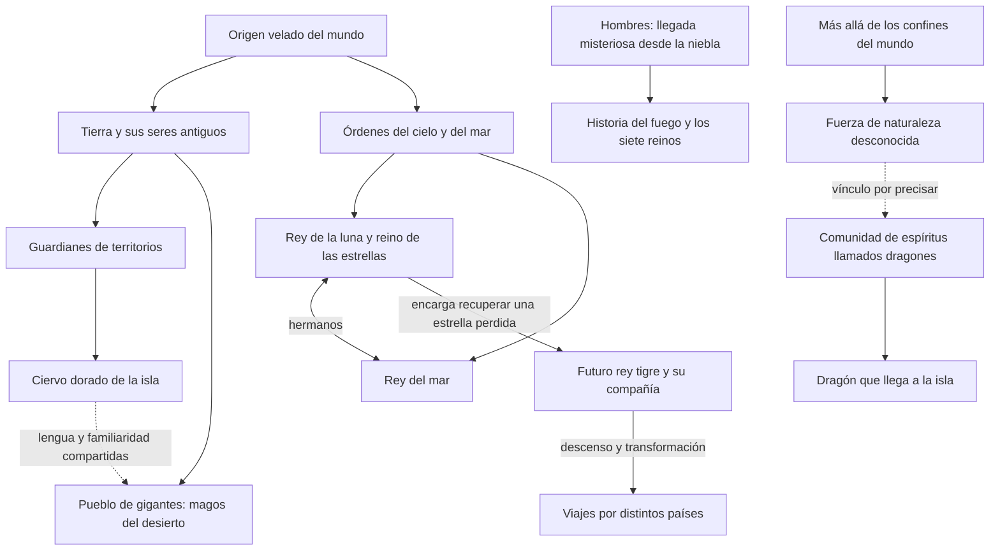
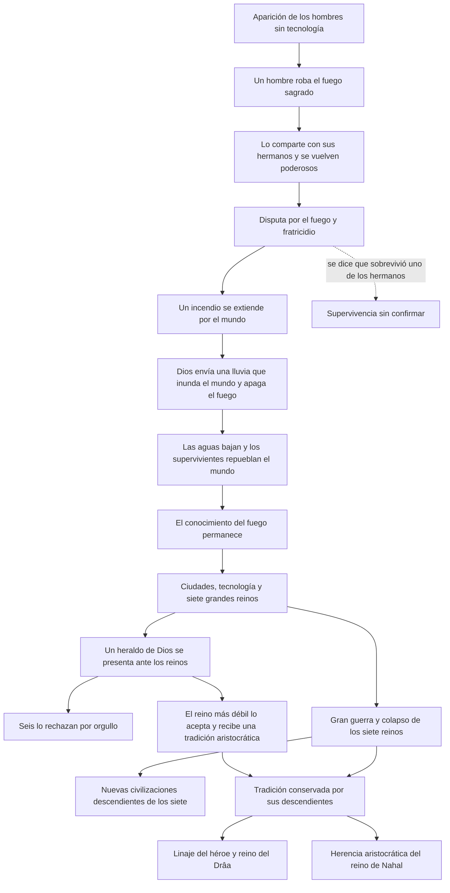
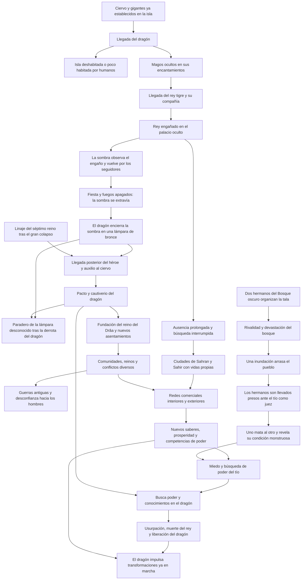

# Borrador: árbol histórico de la isla y sus procedencias

| Campo | Valor |
|---|---|
| Estado | Propuesta para discutir; no modifica el contenido jugable |
| Versión | 0.10 |
| Fecha | 2026-11-11 |

## 1. Cómo leer este árbol

Organiza las ideas conversadas mediante procedencias, llegadas y consecuencias.
Las flechas indican el vínculo escrito junto a ellas: origen, descendencia,
encargo o causa. Compartir una rama no implica parentesco biológico.

Se distinguen tres niveles:

- **Base conversada:** propuestas expresadas por el usuario; siguen siendo un
  diseño en elaboración, aunque sirven como punto de partida de esta versión.
- **Enlace propuesto:** una conexión nueva para discutir, identificada como tal.
- **Contenido actual:** nombres, lugares y vínculos que ya existen en los RON.

El [borrador de drama y mitos](./drama-y-mitos.md) conserva intenciones generales
y referencias. Este árbol desarrolla la nueva línea del rey estelar, su búsqueda
y su nostalgia; las alternativas anteriores sobre su origen no se acumulan aquí.
También recoge la distribución de los reinos y las prioridades de contenido.
No establece reglas, eventos implementables ni fechas de campaña.

## 2. Procedencias anteriores a la historia de la isla

Base conversada. El origen último del mundo y de los hombres permanece abierto.
Antes de la aparición humana ya existen criaturas míticas, hombres tigre y el
pueblo al que pertenecen los llamados magos del desierto. Dios interviene en el
relato del incendio y las aguas; esa intervención no resuelve el origen humano.
La llegada «desde la niebla» expresa metafóricamente ese origen desconocido.

Precisiones de esta base:

- El rey tigre ocupaba un rango alto bajo el rey de la luna. Antes de descender
  era otra clase de ser. Su ligereza, humor y alegría dejan percibir algo de
  aquella naturaleza; también conviven con el deseo de volver a su hogar.
- La transformación afecta a esta compañía. Su historia no explica el origen
  de todos los hombres tigre del mundo ni los somete a todos al mismo rey.
  Los hombres tigre son anteriores a los humanos; todavía no se fecha el
  descenso de esta compañía particular respecto del robo del fuego o las aguas.
- El rey del mar tiene un agravio anterior contra ellos, todavía sin determinar.
  El peligro de navegar y las ofrendas para obtener su favor pueden convivir con
  la necesidad de mantener ciudades portuarias.
- Ciervo y magos se conocen dentro de un ámbito antiguo de la tierra. Todavía
  no se fijó que procedan de un antepasado común. Sus intereses son distintos.
- Los llamados magos pertenecen a un pueblo de gigantes más altos que los
  humanos, sin tamaños descomunales. «Magos del desierto» conserva su uso como
  nombre de trabajo para los habitantes insulares de ese pueblo antiguo.
- «Dragones» designa una comunidad o pertenencia de espíritus, no necesariamente
  una especie zoológica. Son entidades peligrosas y dañinas, ajenas al orden
  del mundo. La cifra de 109 fue un ejemplo provisional.
- Nuestro dragón quiere construir un mundo sometido a ciclos controlados, con
  un interés particular por los hombres, la alquimia y los saberes ocultos.
  Su saber incluye conocimientos humanos: su procedencia exterior no convierte
  toda su obra en algo ajeno a la historia humana.

## 3. La rama humana antes de llegar a la isla

La secuencia siguiente recoge la historia establecida por el usuario. Los
nombres de los protagonistas, los reinos y las épocas siguen sin elegirse.

### 3.1. El fuego, el fratricidio y las aguas

Al comienzo de la historia los humanos ya se encuentran por todas partes, sin
que se conozca exactamente su origen. Carecen de tecnología hasta que un hombre
roba un fuego sagrado y lo muestra a sus hermanos. Estos lo guardan y lo emplean
para hacerse poderosos entre los hombres.

Los hermanos disputan por el fuego y se dan muerte unos a otros. Durante el
combate comienza un incendio que termina extendiéndose por el mundo. Dios envía
una lluvia terrible para inundarlo y apagar el fuego.

Cuando bajan las aguas, algunos supervivientes vuelven a poblar el mundo.
El incendio se ha apagado, pero los hombres conservan el conocimiento del fuego.
Se dice que uno de los hermanos sobrevivió. Esa supervivencia queda como rumor:
no se confirma, no se lo identifica con otro personaje ni se decide qué hizo.

Falta precisar la procedencia del fuego y cómo atravesaron estas catástrofes los
gigantes, los hombres tigre y las demás criaturas anteriores a la humanidad.

### 3.2. Los siete reinos y el heraldo

Después de las aguas, el conocimiento del fuego permite ciudades y grandes
imperios. Siete reinos poderosos y expansivos llegan a dominar el mundo y se
hacen la guerra.

Un heraldo de Dios se presenta ante ellos. Seis lo rechazan por orgullo; el más
débil lo acepta y recibe una tradición aristocrática y una disposición distinta
de las de los otros reinos. A este reino se lo llama provisionalmente «el
séptimo reino». No se han definido su nombre, el mensaje del heraldo ni el
contenido de esa tradición.

En esa época una gran guerra involucra a todos los reinos y los lleva al colapso.
También colapsa el reino que recibió al heraldo. Su aceptación no lo exime de la
catástrofe. Todavía no se establece que la visita del heraldo cause la guerra.

De los siete reinos surgen civilizaciones posteriores. La herencia del séptimo
en Drâa y Nahal se detalla a continuación; las demás filiaciones actuales siguen
sin repartirse.

### 3.3. Las herencias del Drâa y de Nahal

El héroe pertenece al linaje que desciende del séptimo reino y conserva su
tradición aristocrática después del colapso. Esa herencia precede a su llegada
a la isla y al pacto con el ciervo. Su reino, el de la familia del príncipe,
se establece en la cuenca del Drâa.

El reino de Nahal también desciende de esa tradición aristocrática. Su punto
de encuentro con la tradición del Drâa se remonta a muchísimas generaciones;
los habitantes actuales pueden desconocerlo. Las dos herencias han tomado
direcciones que entran en conflicto. Su divergencia concreta y el parentesco
entre sus fundadores o dinastías todavía no están definidos.

El oficio de padre-sacerdote explorado antes podría formar parte de esa
tradición; su vínculo preciso con lo recibido del heraldo sigue pendiente.
También falta decidir qué entregó o perdió el héroe al pactar con el ciervo.

Esta historia proporciona un pasado humano anterior a los conflictos insulares.
Los agravios que recuerdan distintos espíritus pueden proceder de encuentros
de épocas diferentes; todavía no se asignan esos recuerdos a personajes concretos.

## 4. El tronco de la historia insular

La historia insular que sigue sucede después del colapso de los siete reinos.
El orden de las llegadas ya está establecido; no se asignan años ni duraciones.
En el diagrama, las flechas de secuencia expresan orden histórico, no una causa
automática. Los enlaces adicionales se señalan en los apartados correspondientes.

### 4.1. Antes de los reinos

Los gigantes llamados magos del desierto llevan tiempo habitando la isla cuando
llega el dragón. El ciervo está vinculado al territorio. La presencia del dragón
dificulta o impide su poblamiento humano. Los magos se ocultan dentro de sus
encantamientos y pueden eludirlo.

### 4.2. Llegada y engaño del rey tigre

El rey tigre llega con su compañía cuando el dragón todavía no ha sido vencido.
El engaño del palacio ocurre antes de la llegada del héroe humano.

**Enlace propuesto para la llegada:** durante sus viajes, la compañía encuentra
en la isla un indicio de la estrella y establece una escala para investigarlo.
Ese indicio puede conducir a otra parte del mundo; no confirma que la estrella
esté en la isla. La estancia provisional acaba convirtiéndose en una patria.

Los magos temen el poder del rey y engañan a quien consideran extranjero.
Imitan personas o presencias que él recuerda del reino estelar. El rey sospecha
del engaño, pero desea disfrutar del palacio y confía demasiado en su capacidad
de subvertirlo. Prepara para ello la intervención secreta de su sombra. El
[episodio de la sombra y la lámpara](#6-la-sombra-del-rey-y-la-lámpara-de-bronce)
establece cómo falla ese contraengaño.

### 4.3. El héroe, los nuevos pueblos y las generaciones posteriores

El héroe llega después del engaño del palacio. Auxilia al ciervo y con su ayuda
apresa al dragón. Su victoria permite que lleguen otros pueblos, antes
amedrentados por la presencia del dragón, y da origen al reino de su familia.
Tras la derrota del dragón, ya nadie conoce el paradero de la lámpara que
contiene la sombra del rey tigre. La forma del pacto, el cautiverio del dragón
y la entrega del héroe siguen pendientes.

La compañía del rey pierde la continuidad de su misión mientras sus
descendientes desarrollan ciudades, comercio y conflictos propios. La memoria
del viaje puede sobrevivir en relatos, canciones y costumbres cuyo sentido ya
no todos comparten. La seriedad y el cinismo de algunos contrastan con la
ligereza recordada del fundador.

En otras partes de la isla se establecen distintas comunidades humanas,
herederas del mundo posterior al colapso. Algunas
mantienen buenas relaciones con el reino; otras rivalizan con él. Un pueblo o
linaje humano especialmente malvado libra antiguas guerras y ya no permanece
en la isla. Su nombre, procedencia y naturaleza no están fijados. Sus actos
dejan recuerdos entre criaturas que luego juzgan a otros hombres a través de
esa experiencia.

No se decidió que las guerras de ese pueblo causaran por sí solas todas las
enemistades insulares, ni que todos los asentamientos humanos desciendan del
fundador del reino.

### 4.4. La época del padre, el tío y el príncipe

Las influencias exteriores y las iniciativas locales aumentan los conocimientos,
la prosperidad y la competencia. En ciertos lugares se intensifica la guerra;
en otros, nuevas formas de colaboración y producción la vuelven menos necesaria.

#### El juicio que precipita el miedo

Base conversada: dos hermanos son dueños de un gran taller desde el que
organizan la tala de un bosque. Una riña entre ellos se convierte en hostilidades
cada vez mayores. Durante el conflicto talan una cantidad enorme de árboles;
esa devastación provoca una inundación que arrasa un pueblo.

Los hermanos son llevados presos y el tío debe juzgarlos. Durante el juicio uno
mata al otro y revela una condición monstruosa. El homicida declara que ambos
proceden del Bosque oscuro y que de allí viene su fuerza.

El tío queda desconcertado: los órdenes que regían aquel pueblo deberían haber
detenido el conflicto mucho antes. El asesinato ocurre además ante él, en el
espacio donde debía impartir justicia. La experiencia precipita su pérdida de
confianza en la capacidad de sus tradiciones para contener el mal y lo lleva a
temer a la fuerza que procede del Bosque oscuro.

Falta precisar el pueblo, las autoridades que pudieron intervenir y las razones
de sus fallos. La naturaleza monstruosa de los hermanos y la fuerza del bosque
siguen abiertas: no se fija cómo se manifiestan ni quiénes más participan de ellas.

#### Del miedo a la usurpación

El tío busca una seguridad que nunca le resulta suficiente. Interpreta la
confianza y el bienestar de su hermano en el trono como una pérdida de fuerza
para gobernar. El padre del príncipe se resiste a esa búsqueda de poder; el
juicio da a su divergencia un acontecimiento concreto sobre el que enfrentarse.

La interpretación del tío no establece por sí sola que toda la tradición sea
impotente. Él conserva la responsabilidad de sus decisiones: se diseña como
villano y oponente capaz de presentar un combate directo y difícil al jugador.

La búsqueda de conocimientos lo acerca al dragón. También quiere conseguir
aquello que el antepasado entregó al ciervo, interpretándolo como un objeto de
poder que podría otorgarle legitimidad y fuerza para dominar la isla. La forma
de esa entrega y su verdadero poder todavía no están elegidos.

Al descubrir lo que su hermano ha estado haciendo, el rey lo enfrenta y ambos
se vuelven rígidos en sus posturas. El conflicto desemboca en la usurpación y
la muerte del rey. Se explora que el dragón haya contado con ese descubrimiento
o lo haya favorecido para precipitar el enfrentamiento. Su explotación del
miedo del tío no lo convierte en autor de todas las causas de la crisis.

La ayuda concreta que ofrece el dragón sigue por diseñar. La alquimia es una
posibilidad, todavía sin un don elegido. También falta precisar la comunicación
con el dragón cautivo y la manera en que el tío consigue liberarlo.

El dragón encuentra ambiciones y temores que puede estimular. Su proyecto
favorece una concentración de conocimientos y funciones: actividades antes
realizadas por muchas comunidades pasan a depender de unos pocos centros.
Su expansión puede ofrecer beneficios reales mientras reduce la capacidad de
las comunidades para sostener y transformar esas actividades por su cuenta.
La novedad, el comercio o la alquimia no determinan por sí solos ese resultado.

#### Conexiones para desarrollar al escribir

Son lecturas y posibilidades de desarrollo; no agregan sucesos al episodio:

- **El eco del fuego y las aguas.** Otra disputa entre hermanos hace que el uso
  de una fuerza repercuta sobre muchas otras personas. En el mito primordial
  el agua apaga el incendio; aquí la inundación es la calamidad y precede al
  fratricidio. La semejanza no convierte este desbordamiento en un castigo divino.
- **El fracaso vivido por el juez.** Su miedo afecta también a su propia
  autoridad: tampoco su intervención ha logrado impedir el asesinato. Puede
  buscar un poder que le evite volver a experimentar semejante límite.
- **La repetición en sus propias decisiones.** El futuro usurpador acabará
  matando a su hermano después de haber presenciado aquel fratricidio
  monstruoso. El dragón puede ayudarlo a presentar su violencia como una
  excepción necesaria, pero la elección sigue siendo suya.

Los motivos de pérdida, búsqueda de seguridad absoluta, poder insaciable y vida
guardada fuera del cuerpo se conservan entre las
[referencias para explorar](./drama-y-mitos.md#7-referencias-y-cuestiones-para-seguir-explorando).
Su posible adaptación a la oferta del dragón todavía queda abierta.

Las familias, la fuga de la sirvienta, los parientes separados y la propuesta de
vínculos dramáticos se desarrollan en
[`vinculos-familia-real.md`](./vinculos-familia-real.md). Allí queda fijado que
todo personaje se diseña para funcionar como NPC o personaje jugador: sus
hechos y vínculos se escriben por autoría, sus acciones NPC necesitan
instrucciones y el jugador interpreta al Actor que controla.

Este es el comienzo de una época de campaña, no una cadena de desenlaces
obligatorios. Su desarrollo posterior admite intervención del jugador y finales
distintos, también cuando el príncipe actúe como NPC.

## 5. Regiones, reinos y prioridades de contenido

La referencia de nombres, valores y diferencias culturales se reúne en
[Culturas, ciudades y nombres](./culturas-y-sociedades.md). Este árbol conserva
sus procedencias históricas y su distribución territorial.

Los nombres geográficos y las ciudades citadas existen en
[`content/base/places/`](../../../content/base/places/). La organización política,
los nuevos habitantes y las prioridades siguientes pertenecen al diseño del
usuario; todavía no están materializados en ese contenido. Se usan los nombres
actuales Azrum, Qadim y Debaret para las referencias de la conversación a
«Azturun», «Kadim» y «Varet».

### 5.1. El reino del príncipe y el reino del sur

El reino del príncipe está en la **cuenca del Drâa**. Su acceso desde el occidente
lo sitúa en el espacio de juego más habitual: las ciudades occidentales, el
desierto, el cruce de la cordillera y el reino del norte. Tazar, Ur Eshan,
Esh Kadur, Naram y Til Azur son los asentamientos actuales de la cuenca; todavía
no se fijaron su capital ni sus funciones dentro del reino.

En el **país de Nahal** existe otro reino, asociado al territorio de Nahal,
Nalume, Teshara y Sulún. Explorar el bosque y alcanzar ese país será, como
intención de diseño, más complicado que moverse entre el occidente y el Drâa.
Las razones concretas de esas dificultades quedan por desarrollar.

Ambos reinos llevan la antigua herencia descrita en
[la rama humana](#33-las-herencias-del-drâa-y-de-nahal), pero sus tradiciones
actuales son incompatibles en aspectos importantes todavía por definir.
Su oposición debe surgir de cómo entienden y practican esa herencia. La
antigüedad del origen común permite que los propios personajes lo desconozcan.

### 5.2. Occidente: ciudades independientes y dos zonas

El **occidente es la prioridad principal de autoría**. Una parte importante de
la historia podrá transcurrir allí; deberá ofrecer la mayor concentración de
personajes, conflictos, acontecimientos y actividades para el jugador.

Se distinguen dos zonas de trabajo:

- **Norte:** las ciudades de las Tierras de Sahran, actualmente Zarabad,
  Shahraz, Nuris y Azraván.
- **Sur:** las ciudades de la Península de Sahir, actualmente Mehrabad, Qasar,
  Dar Nazir y Zafirat, con los pueblos de Nahris y Safra.

Entre ambas, la **Hamada Roja** es muy inhóspita y difícil de cruzar. Para
desplazarse de una zona a otra, las ciudades recurren normalmente a la
navegación y evitan esa travesía terrestre. Este criterio orientará el futuro
diseño de lugares, relaciones y dificultades de viaje.

Cada ciudad hace su propia vida, desarrolla su sociedad y actúa casi como un
reino. Los nombres regionales son geográficos; la historia compartida de la
compañía del rey tigre deja raíces comunes entre sociedades independientes.
Como primer conflicto local, el usuario eligió la guerra entre Zarabad y Nuris.
El rey de Zarabad compra al príncipe para el servicio naval si se concreta la
venta del Bandido. Zarabad y Nuris se disputan el control de la salida comercial
del Mar del Viento. Atacan barcos y presionan a sus vecinos; sus murallas y la
escasez de medios para asediar dificultan una conquista definitiva. El incidente
que inicia la guerra y las posiciones de las otras ciudades siguen abiertos.
La apertura en Costa Ámbar y el nuevo reparto
se desarrollan en
[Primeras aventuras en el norte de Sahran](./sahran-apertura-y-personajes.md).

### 5.3. Bosque, cordilleras y Debaret

| Área | Base de diseño y aspectos abiertos |
|---|---|
| Bosque de Tamrut | Habrá una presencia peligrosa, semejante a un reino oculto, con algún lugar al que se pueda ir. Los hermanos del juicio declaran proceder del Bosque oscuro y obtener allí su fuerza. Su naturaleza y su relación con las demás presencias del bosque siguen abiertas. |
| Cordillera de Azrum | Tendrá una presencia propia: podría ser un pueblo, una civilización o una ciudad que controle la cordillera. Su identidad humana o mitológica todavía no está elegida. |
| Montes de Qadim | Tendrán otra presencia distinta de la de Azrum, con las mismas posibilidades de escala todavía abiertas. La referencia a los enanos de Tolkien expresa una posibilidad de vida montañesa, no una elección de especie. |
| Debaret, ciudad del Valle Gris | Pertenece a una civilización humana con tradición propia, distinta de las otras sociedades humanas insulares. Su protagonismo suele ser menor, pero determinadas combinaciones de acontecimientos podrían volverla decisiva y cambiar la historia de toda la isla. Esos acontecimientos no están diseñados. |
| Isla del Exilio | Su función narrativa se deja para más adelante. |

Debaret conserva una identidad separada de la presencia que se diseñe para los
Montes de Qadim. La importancia excepcional de la ciudad dependerá de lo que
suceda en una partida; no se convierte en una etapa obligatoria de todas ellas.

### 5.4. Procedencias e influencias exteriores

Las conexiones geográficas propuestas antes siguen abiertas: una etapa del
linaje del héroe en Meridia, una llegada nororiental relacionada con el
poblamiento del Drâa y otra desde Kémbu relacionada con Debaret. Son **enlaces
propuestos**. La ascendencia aristocrática común del Drâa y Nahal ya pertenece
a la base conversada; su procedencia geográfica intermedia queda por decidir.
Meridia, Kémbu y Arshun aún no se identifican con ninguno de los siete reinos.

| Sociedad exterior existente | Contactos y posibilidades de conexión |
|---|---|
| Talassia y Vardanes, en Meridia | Sus culturas son distintas. Sus intercambios ponen en contacto talleres, navegación y metales; podrían transportar también conocimientos y prácticas. |
| Kembara, en Kémbu | Sus contactos con los puertos occidentales permiten llegadas de viajeros y tradiciones diferentes de las procedentes de Meridia. |
| Ishkarun, puerto del Imperio de Arshun | Sus vínculos con Til Azur y Nahal pueden introducir conocimientos y formas de organización de una potencia mayor. Los propósitos de sus habitantes y autoridades quedan por diseñar. |

Ejemplos actuales que sostienen esos contactos: Dar Nazir comercia con
Talassia; Zarabad con Vardanes; Zafirat con Kembara; Til Azur y Nahal con
Ishkarun. Ur Eshan abastece a Mehrabad y esta comercia con Debaret. Las
mercancías y declaraciones exactas permanecen en sus RON.

Las influencias exteriores estarán repartidas por lugares de toda la isla,
mediante personas, intercambios y costumbres concretas. Las cuatro ciudades
exteriores pertenecen a historias más amplias; su relación con la isla es una
parte de ellas.

## 6. La sombra del rey y la lámpara de bronce

Esta versión recoge el episodio propuesto por el usuario. Reemplaza el encargo
anterior de una visita que no llegaba a cumplirse.

### 6.1. El contraengaño

El rey sospecha que hay una trampa, pero quiere disfrutar de la recepción de los
magos y cree poder adelantarse a ellos. Deja su sombra para que observe a
escondidas lo que él, dentro del engaño, no puede ver. La sombra llega
secretamente al palacio, reconoce lo que está ocurriendo y conoce el camino.
Debe volver a buscar a los seguidores y guiarlos hasta allí para rescatar al rey.

### 6.2. La fiesta de los seguidores

Los seguidores también se dejan llevar por la nostalgia. Celebran una fiesta,
se emborrachan y dejan que se apaguen los fuegos. Sin su luz, nadie puede ver
a la sombra, que se pierde durante el camino de vuelta.

El rey se ha confiado demasiado en su astucia; sus seguidores también se han
confiado. Estos errores ponen en peligro el plan, pero todavía podrían haberse
remediado sin la intervención del dragón.

### 6.3. La intervención del dragón

El dragón encuentra a la sombra extraviada y, con su propia astucia, la captura
en una lámpara de bronce que contiene una vela que no se apaga. La sombra queda
pequeña, encerrada dentro, sin poder escapar. Al despertar al día siguiente,
los seguidores no la encuentran.

La intervención del dragón frustra el rescate y prolonga la separación. Cuando
el héroe vence y apresa al dragón, ya nadie sabe dónde está la lámpara.

### 6.4. Continuación pendiente

La sombra conserva en esta historia la función de testigo y guía del camino al
palacio. Falta decidir dónde quedó la lámpara, cómo se podría liberar a la
sombra y cómo se desarrollaría el rescate del rey. No se ha establecido que el
héroe conociera la lámpara o intentara encontrarla.

La observación secreta de la sombra pertenece a este episodio; no define por sí
sola una inmunidad general frente a encantamientos. El retorno del rey y la
autoridad que reconocerían las ciudades actuales siguen abiertos.

### 6.5. Resonancias que conservar al escribir el episodio

Estas lecturas fueron aceptadas como conexiones útiles para la escritura; no
agregan hechos ni reglas al relato:

- **Dos banquetes y una misma nostalgia.** El rey y sus seguidores se permiten
  disfrutar porque se sienten seguros. El contraengaño depende de una tarea
  compartida y falla cuando se pierde esa vigilancia.
- **Dos usos de la luz.** Los fuegos compartidos que debían permitir el regreso
  se extinguen; la luz encerrada del dragón permanece y mantiene cautiva a la
  sombra. La inversión simbólica tiene consecuencias físicas en el cuento.
- **El artificio del dragón.** La lámpara resuena con su proyecto de controlar
  y confinar mediante conocimientos y artificios. Su intervención vuelve
  duradero un contratiempo que todavía podía remediarse.
- **Una victoria con consecuencias pendientes.** La derrota del dragón permite
  nuevos asentamientos, mientras la sombra sigue cautiva. El héroe y el rey tigre
  quedan relacionados por esa consecuencia que futuras personas pueden descubrir.

## 7. Decisiones que darían forma al siguiente borrador

1. **Divergencia de las tradiciones aristocráticas.** Precisar qué conservan
   Drâa y Nahal de su raíz común y qué los enfrenta en la vida actual.
2. **Herencias de los siete reinos.** Elegir qué conservan las civilizaciones
   posteriores, cómo se relaciona el oficio de padre-sacerdote con la tradición
   recibida del heraldo y qué contactos recuerdan los espíritus antiguos.
3. **Las catástrofes y los pueblos anteriores.** Precisar sus consecuencias
   para gigantes y hombres tigre, manteniendo sin confirmar el rumor del hermano
   superviviente.
4. **La escala que se volvió patria.** Elegir por qué se detuvo allí la compañía
   y qué parte de la búsqueda siguió realizando antes de perder a su rey.
5. **Del juicio al enfrentamiento familiar.** Precisar los fallos que precedieron
   a la inundación, la condición de los hermanos, la respuesta del rey y la ayuda
   concreta del dragón. El juicio ya está elegido como detonante del miedo.
6. **Habitantes del bosque y las cordilleras.** Elegir quiénes viven allí, qué
   quieren y cómo se relacionan con los lugares y pueblos vecinos.
7. **El protagonismo excepcional de Debaret.** Diseñar qué acontecimientos
   pueden volverla decisiva sin imponer ese recorrido en todas las partidas.

La ubicación del reino del príncipe en el Drâa ya está elegida. Queda pendiente
adaptar las biografías actuales de príncipe, rey y tío, que todavía dicen que
proceden de otro continente. Este borrador no modifica esos RON ni la red de viaje.

Los orígenes remotos pueden conservar partes desconocidas. La historia cercana
necesita personas, decisiones y consecuencias precisas para que los recuerdos
y conflictos del presente tengan peso.
