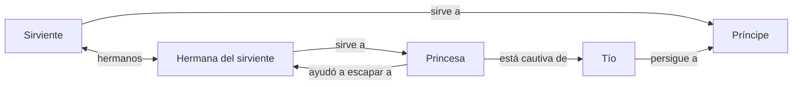

# Borrador: vínculos y drama de la familia real

| Campo | Valor |
|---|---|
| Estado | Diseño de contenido en elaboración; no modifica código ni RON |
| Versión | 0.8 |
| Fecha | 2026-11-11 |

## 1. Propósito y criterio de autoría

Desarrollar las relaciones inmediatas de la usurpación descrita en el
[árbol histórico](./arbol-historico-isla.md#44-la-época-del-padre-el-tío-y-el-príncipe).
Se distinguen la base conversada y las propuestas de vínculos todavía por elegir.

**Decisión del usuario:** todos los personajes deben diseñarse de modo que
puedan funcionar como NPC o como personaje jugador. Ahora se trabaja con el
príncipe como protagonista; la futura elección de otros protagonistas no cambia
el pasado ni los vínculos de esos Actores.

Se establecen hechos, relaciones, estados y conductas observables, dejando
espacio para interpretar su significado interior. La muerte del padre, los
actos del tío y los encuentros vividos no imponen odio, perdón o deseo de venganza
al jugador que controle a un personaje afectado por ellos.

Cuando el Actor funciona como NPC, las instrucciones y los eventos de autoría
deciden sus acciones dentro del mundo. Las relaciones les dan contexto, pero no
producen por sí solas una conducta ni simulan una psicología completa. Cuando lo
controla el jugador, sus elecciones pasan a decidir las acciones correspondientes.
Los hechos y las reglas que afectan al personaje se conservan en ambos casos.

Las relaciones [Desea, Debe, Necesita y Es llamado a](./conceptos-relaciones-y-finales.md)
hacia Conceptos expresan lo que está en juego en esa vida y orientan sus finales.
En el príncipe, la recuperación o no del trono sigue siendo relevante para el
desenlace, aunque el jugador elija perseguir otros propósitos.

El espacio de interpretación no vuelve irrelevantes su carácter, sus preferencias
o sus vínculos. Las situaciones escritas deben distinguir entre conductas
plausibles, improbables e incompatibles con las personas involucradas. No se
requiere ofrecer todo desenlace imaginable ni darles la misma probabilidad o
el mismo valor. Los finales pueden ser más o menos favorables; no hay obligación
de compensar cada pérdida con un beneficio equivalente.

Como ejemplo de diseño, un estado `furioso` podría hacerse visible y tener algún
efecto reglado, sin explicar contra quién o por qué siente furia el personaje.
Todavía no se eligieron sus efectos ni las escenas que lo aplicarían. Ese estado
no garantiza que el jugador experimente la misma emoción.

Se buscan **dos o tres vínculos dramáticos centrales por personaje**, además de
los parentescos y hechos de contexto necesarios. Es un criterio para concentrar
el drama, no un límite del número de relaciones que admite un Actor.

## 2. Base conversada: familias y acontecimientos

### El sirviente, su hermana y la princesa

- El padre del sirviente murió el día del golpe, durante los enfrentamientos
  entre soldados del rey y del tío. No se ha decidido su función ni quién lo mató.
- El sirviente tiene una hermana que sirve a la hermana del príncipe, la princesa.
- La princesa está prisionera del tío. Se ha propuesto como costumbre del Drâa
  que ella no herede el trono, pero que sus hijos puedan tener derechos sucesorios.
- Durante la partida, la princesa ayuda a escapar a su sirvienta. Esta puede
  encontrarse después con el príncipe e incorporarse a su grupo.
- La interacción con esa nueva compañera permite conocer a la princesa mediante
  sus actos y sus relaciones, antes de encontrarla personalmente.

La fuga ocurre durante la partida: el hecho de que la princesa la ayudó a escapar
se registra después de ese acontecimiento, no como historia ya sucedida al inicio.
La muerte del padre también puede afectar a la hermana; su postura todavía no
está definida.

### El primo y la familia separada

La mayoría de las familias nobles se alineó con el tío tras su victoria.
Muchas tienen parentesco con la casa real. Un primo del príncipe se negó a
ponerse de su lado y huyó con su padre, dos hermanos y dos hermanas. Durante
la huida quedaron separados. Son seis personas; el hermano mayor cautivo es
uno de esos dos hermanos, no un familiar adicional.

El hermano mayor se conserva como rehén para controlar a los demás. Mientras
continúe cautivo, la familia no se atreve a participar en una guerra a favor del
príncipe. Encontrarlos puede permitir reclutarlos; incorporarse al grupo no
equivale por sí solo a iniciar esa guerra. Rescatar al rehén elimina la coacción
que impedía su apoyo bélico. Las escenas concretas se escribirán por autoría.

La rama y el grado de parentesco del primo, los nombres, las ubicaciones y el
responsable directo de custodiar al rehén siguen pendientes. La familia puede
existir como contexto mientras se desarrolla primero al primo y al cautivo.

La madre del príncipe ya tiene una ficha inicial. Su postura en esta historia
sigue abierta. La esposa del tío y otros cortesanos todavía no tienen un papel
elegido para este núcleo.

## 3. Propuesta de vínculos centrales

Los hechos de la sección 2 son la base. Los afectos, compromisos y el pasado de
aprendizaje de la tabla son **propuestas para discutir**, no decisiones añadidas
a los datos del juego. Las etiquetas están escritas como lenguaje de diseño.
Las prioridades propuestas orientan conductas NPC; su interpretación interior
queda abierta y no obliga al jugador que controle a ese Actor a actuar igual.

| Personaje | Dos o tres vínculos para articular su conflicto |
|---|---|
| Príncipe | Es perseguido por el tío; tiene al sirviente como compañero; **se propone** que antes fuera discípulo del tío. Su conducta como NPC todavía necesita instrucciones de autoría; al controlarlo, el jugador decide su postura. |
| Tío | Persigue al príncipe; mantiene cautiva a la princesa; colabora con el dragón. |
| Princesa | Está cautiva del tío; **se propone** que confíe en su sirvienta; durante el evento la ayuda a escapar. |
| Sirviente | Sirve al príncipe; **se propone** que tema por su hermana y quiera vengar a su padre. Esa combinación puede enfrentar su deseo de salvar a alguien vivo con el de ajustar cuentas. |
| Hermana del sirviente | Sirve a la princesa; después de la fuga fue ayudada por ella a escapar; **se propone** que busque a su hermano hasta reencontrarse con él. Su compromiso posterior con la princesa queda por definir. |
| Primo fugitivo | Se opone al tío; **se propone** que tema por su hermano cautivo y busque a su padre. Los otros hermanos y hermanas conservan sus vínculos familiares de contexto. |
| Madre del príncipe | **Se propone** que tema por sus hijos y priorice reunir a su familia. Eso podría enfrentarla con una restauración que los exponga a nuevos peligros. |

**Pasado propuesto para el príncipe:** un único vínculo de aprendizaje con el tío
permitiría que conociera y hubiera valorado capacidades de su actual enemigo.
No se han elegido todavía su materia, sus recuerdos concretos ni una confianza
automática en todo lo que hizo aquel maestro.

En la rama del sirviente, el vínculo narrativo después de la fuga se lee así:

El parentesco fraterno del diagrama puede deducirse de la filiación; no obliga a
declararlo una segunda vez. Un hecho y su lectura inversa, como «ayudó a escapar»
y «fue ayudada a escapar», describen el mismo vínculo.

## 4. Qué debe hacer visible cada vínculo

Cada vínculo central debe aportar una experiencia concreta: algo que el personaje
hace, desea, teme o recuerda respecto de otra persona. El parentesco permite
encontrar a esa persona; las acciones y posturas revelan el conflicto entre ellas.

En el recorrido propuesto con el príncipe, la ayuda de la princesa precede al
encuentro del jugador con ella. La sirvienta puede contar y mostrar consecuencias
de esa experiencia mientras convive con el grupo. Su relato y su conducta tienen
que darle voz propia; no queda reducida a explicar la biografía de la princesa.
Otros protagonistas podrán experimentar esas relaciones desde otra posición.

Un hecho compartido no determina una emoción: recibir ayuda no impone obediencia,
perder a un familiar no impone venganza y tener un enemigo común no define todas
las lealtades. Las escenas concretas muestran lo que hacen y dicen los NPC.
El jugador interpreta y elige la postura del Actor que esté controlando.

El modelo actual ya representa parentesco, servicio y relaciones de muerte.
Las nuevas etiquetas dramáticas de este borrador requieren un diseño técnico
antes de incorporarse a los archivos RON, las fichas o los eventos. Tampoco se
presupone que toda intención deba convertirse en un tipo de relación: primero
se elegirá qué vínculos sostienen realmente las escenas.

## 5. Un antagonista cercano para experimentar el conflicto

### 5.1. Escala de la partida

**Criterio del usuario:** una partida transcurre rápidamente en tiempo real y
puede abarcar un período histórico extenso. El ejemplo de cinco horas de juego
durante las que pasan cien años expresa esa escala; no fija una conversión de
tiempo ni la duración obligatoria de todas las partidas.

Un gran acontecimiento puede resolverse en una sola acción general, mediante
una sucesión de viñetas. El usuario toma como ejemplo que cada enfrentamiento
de Beowulf con Grendel o con el dragón podría ocupar una acción de atacar.
La importancia del suceso proviene de lo que cambia, aunque su resolución ocupe
poco tiempo real. Esto orienta también el encuentro con el enviado: no necesita
convertirse en una persecución larga de apariciones sucesivas para tener peso.

### 5.2. Apertura propuesta por el usuario

El príncipe y el sirviente naufragan en Costa Ámbar o en un nuevo lugar cercano;
la posición definitiva sigue abierta. El bandido los encuentra en la orilla,
ve una oportunidad y decide ayudar al príncipe. Es un pirata, ladrón y
buscafortunas sin fidelidad estable a una ciudad. Les propone ir a la ciudad
que suele frecuentar y visitar a su rey, donde podrían encontrar ayuda.
El usuario eligió **Zarabad** como esa ciudad. Los nombres personales siguen
en elaboración.

Ese rumbo permite entrar en la política y los problemas de Sahrán. El jugador
conserva la libertad de ir a otros lugares. Las relaciones, las oportunidades y
los incentivos iniciales deberían hacer que un principiante tienda a seguir la
propuesta, sin imponerla como itinerario obligatorio.

**Nueva propuesta del usuario:** el Bandido quiere vender al príncipe al rey.
Este lo compra y lo mantiene como servidor y guerrero para sus barcos. Su
ciudad comercia por mar y está en guerra con **Nuris**; sus barcos pueden
sufrir ataques piratas y también practicar la piratería. La situación del
príncipe es de servicio guerrero forzoso, aunque su función y su trato difieran
de otras formas de esclavitud. «Mercenario» se aproxima a su actividad militar,
pero no describe una contratación voluntaria.

Antes de visitar al rey, un evento narrativo debe dar una pista de la venta y
de los intereses del Bandido. Tiene que ocurrir a tiempo para permitir que el
jugador actúe: puede buscar otras ventajas en la ciudad y evitar esa captura.
La advertencia, las acciones posibles y los requisitos del encuentro siguen
por escribir; no se fija que todos los visitantes sean capturados.

La rama cautiva reduce parte de la agencia del príncipe y concentra una
demostración de las mecánicas mediante su servicio naval. Puede darle armas,
aliados o aprendizaje para mejorar su situación. Estos beneficios forman parte
de la propuesta, sin cantidades ni recompensas garantizadas todavía. La
duración, las restricciones precisas y las formas de recuperar la libertad
siguen pendientes. No se ha decidido qué ocurre con el sirviente ni si el
Bandido continúa en el grupo tras la venta.

El usuario propone que al principio el movimiento quede subordinado a órdenes
de un capitán y que después el príncipe pueda ganar autonomía aunque continúe
esclavizado. Hace falta conservar acciones con duración para que esa etapa
avance en el tiempo. Los encargos y los pasajes en barcos ajenos se desarrollan
como propuestas en el borrador de Sahran, sin dar por implementada una prohibición
global de viajar ni una campaña naval automática.

La práctica de este rey no define a todas las ciudades occidentales. Las
referencias culturales y de nombres se reúnen en
[Culturas, ciudades y nombres](./culturas-y-sociedades.md).

Un desierto central extenso, caluroso y sin agua hará difícil ir al sur a pie
desde el naufragio, conservando esa posibilidad. El norte y la propuesta del
Bandido deben ofrecer un rumbo inicial razonable. El servicio naval puede
dar al príncipe una base y personas amigas en Zarabad, e involucrarlo en su
guerra sin determinar su lealtad definitiva. La zona, el reparto y los primeros
eventos se desarrollan en
[Primeras aventuras en el norte de Sahran](./sahran-apertura-y-personajes.md).

La experiencia de partidas anteriores permite reconocer el peligro y buscar
otro rumbo. El jugador también puede advertirlo en su primera partida mediante
la pista. Tanto esa alternativa como el servicio naval pertenecen a la etapa
errante: todavía no hay una presión constante del enviado o de las fuerzas del
tío. Recuperar el trono queda fuera de las posibilidades habituales con los
medios iniciales; volver al reino es peligroso porque lo buscan. Esto describe
la situación en el mundo sin establecer una prohibición artificial de intentarlo.

### 5.3. El primer gran obstáculo

**Propuesta del usuario:** el enviado del tío, que intenta matar al príncipe,
funciona como primer gran obstáculo probable. Se sitúa entre la etapa del
príncipe errante y aquella en que empieza a reunir medios para enfrentar el
problema del trono. Los vínculos y los eventos deben favorecer que muchas
partidas conduzcan a ese enfrentamiento, sin volverlo un requisito de todo
recorrido posible.

La convivencia y las aventuras anteriores dan al jugador una oportunidad de
apreciar al sirviente. Se busca que un desenlace frecuente del encuentro sea
su muerte, pero también que haya otros resultados y que aprender las mecánicas
permita maniobrar para evitarla. La probabilidad, las circunstancias del peligro
y las alternativas concretas todavía no están diseñadas.

El usuario precisa que, en general, perder al sirviente debe conducir a
resultados menos favorables que conservarlo. Las distintas continuaciones y
finales no necesitan ser igual de frecuentes ni igual de buenos. Que la
partida pueda continuar después de la pérdida no obliga a equilibrar sus
consecuencias con las de haber logrado protegerlo.

La pérdida tendría su peso en una relación experimentada durante la partida.
El vínculo del enviado con el tío conecta esa experiencia con la usurpación.
No se prescribe qué emoción debe sentir el jugador ni se recurre a una atrocidad
gratuita contra inocentes para provocar rechazo.

**Criterios propuestos para desarrollar el encuentro:**

- El peligro debe poder entenderse y afrontarse mediante recursos y decisiones
  del juego: por ejemplo, reunir apoyo, preparar una retirada o evitar una
  situación desfavorable. Son alternativas de diseño, todavía sin reglas.
- La muerte posible del sirviente debe surgir de las circunstancias y de la
  resolución del encuentro. Su frecuencia no debe depender de una muerte
  obligatoria que ignore lo que hizo el jugador para protegerlo.
- Salvar al sirviente debe conservar consecuencias e interés narrativo. Su
  supervivencia deja abiertas sus relaciones, incluida la de su hermana.
- Encontrar al enviado, perder al sirviente y vencer al enviado son resultados
  distintos; no se fija que deban ocurrir juntos ni en un orden obligatorio.

### 5.4. Perspectivas y asuntos pendientes

La persecución se dirige al príncipe por su identidad en la historia,
independientemente de quién sea el personaje jugador. Al controlar al sirviente,
al bandido u otro Actor, cambian la participación y las elecciones disponibles.
Una eventual exposición del sirviente al peligro debe contemplar quién lo
controla, de acuerdo con el criterio de autoría de la sección 1.

La propuesta anterior de que el enviado fuera un servidor de la antigua casa
real, conocido del príncipe y del sirviente, sigue disponible para discutir.
Reclamar obediencia al nuevo rey o intentar separar al grupo eran posibilidades
de ese planteo; no son hechos elegidos para el encuentro actual.

Queda por definir quién es el enviado, qué circunstancias lo llevan hasta el
grupo, cómo se anuncia o se descubre el peligro, qué sucede durante el encuentro
y qué cambia tras cada desenlace. La apertura y este obstáculo siguen siendo
diseño de contenido; no cambian todavía los RON ni los eventos ejecutables.

En el contenido ejecutable, el Bandido conserva una relación `Sirviente` hacia
el príncipe y una biografía mínima de compañero. Esa relación no prueba la
lealtad del nuevo personaje propuesto: habrá que revisar esos datos cuando se
implemente la apertura. Tampoco se ha cambiado el grupo ni el lugar iniciales.

Tampoco se ha elegido qué representa para el príncipe su exilio: pérdida de
hogar, tristeza, desorientación o desconexión de un vínculo sagrado son
posibilidades para explorar mediante acontecimientos y signos.
